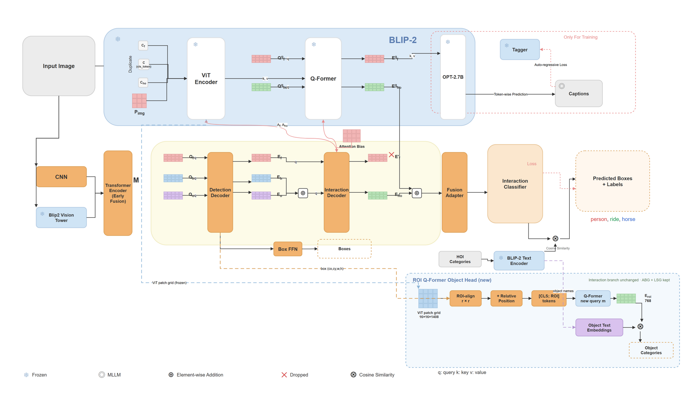
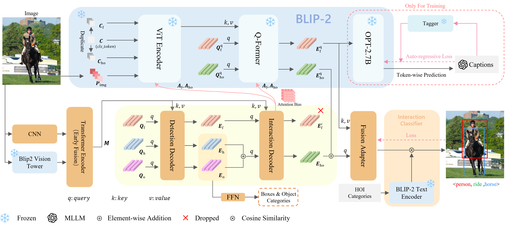

# BC-HOI-Adapted

> Open-Vocabulary Human-Object Interaction Detection with BLIP-2 / OPT.

## 📑 目录

- [⚡ 0. 最小可运行方案](#0-最小可运行方案)
- [📁 1. 项目目录](#1-项目目录)
- [🧠 2. 核心模块](#2-核心模块)
- [⚙️ 3. 环境安装](#3-环境安装)
- [📦 4. 数据与权重准备](#4-数据与权重准备)
- [🚀 5. 训练](#5-训练)
- [📊 6. 评测](#6-评测)
- [🎯 7. ROI 物体头（可选）](#7-roi-物体头可选)
- [📈 8. SwanLab 日志（可选）](#8-swanlab-日志可选)
- [❓ 9. 常见问题](#9-常见问题)
- [🎬 10. V-COCO](#10-v-coco)
- [🔗 原始 BC-HOI 仓库](#原始-bc-hoi-仓库)

---

本项目基于 **BC-HOI**（*Bilateral Collaboration with Large Vision-Language Models for Open Vocabulary Human-Object Interaction Detection*, ICCV 2025）整理和适配。核心思想是利用检测器的交互注意力图引导 BLIP-2 的视觉编码（ABG），并用 LLM 的逐 token 生成损失监督检测器（LSG），最终通过视觉特征与文本嵌入的余弦相似度实现开放词汇的 HOI / 物体分类。

论文：<https://arxiv.org/abs/2507.06510>

<p align="center">
  
</p>
<p align="center">
  <i>改进后的模型架构：在 BC-HOI 的 ABG / LSG 基础上加入 ROI-align + Q-Former 物体头</i>
</p>

<p align="center">
  <span style="color:#e63946;font-weight:bold;">🔥 改进版 ROI 物体头</span> ·
  <span style="color:#2a9d8f;font-weight:bold;">✅ Linux / macOS / Windows 已适配</span> ·
  <span style="color:#457b9d;font-weight:bold;">📈 SwanLab 实验记录</span>
</p>

<details>
<summary>🖼️ 原始 BC-HOI 架构图（点击展开）</summary>



</details>

本项目在原始 BC-HOI 代码基础上，还完成了以下工程化改动：

- 🛠️ 修复了 BLIP-2/LAVIS 在 PyTorch 2.5、Transformers 4.57、Windows 环境下的导入和 API 兼容问题；
- 📦 新增 HICO-DET 图片 / PPDM 标注的下载与转换脚本；
- 🎯 新增可选的 **ROI-align + Q-Former 物体头**（见 `ROI_QFormer_OBJ_HEAD_PLAN.md`）；
- 📈 接入 **SwanLab** 训练/评测日志；
- 🖥️ 新增单卡训练、单卡评测和 UTF-8 控制台适配。

> <span style="color:#d62828;font-weight:bold;">⚠️ 数据和预训练权重不随仓库提供</span>，需要按第 4 节准备。

> 🌍 <span style="color:#457b9d;font-weight:bold;">可移植性说明</span>：以下命令默认在 **仓库根目录** 执行，使用激活环境中的 `python`，不依赖任何本机绝对路径。Linux / macOS / Windows（Git Bash 或 WSL）均可；Windows 的 `.sh` 脚本请在 Git Bash/WSL 中运行，或把脚本里的 `python main.py ...` 命令复制到 PowerShell 执行。

---

## 0. 最小可运行方案

> <span style="color:#2a9d8f;font-weight:bold;">目标</span>：用 **32 张训练图 + 8 张测试图** 的小子集，把“数据 → 训练 → 评测”整条链路跑通，先验证环境、显存和接口，再上完整 HICO-DET。

> <span style="color:#d62828;font-weight:bold;">⚠️ 显存提醒</span>：小数据子集只减少训练时间，**不会减少模型显存**。BLIP-2 ViT-g + OPT-2.7B 仍需约 10 GB 权重，建议 **≥24 GB 显存**（8 GB 会 OOM）。

### 0.1 前置检查

```bash
# 环境名只是示例；换成你实际创建的 conda/venv 名称
conda activate bchoi

# 确保当前目录是仓库根目录（包含 main.py、lavis/、data/）
python -c "import torch, transformers, timm, lavis; print('✅ environment OK')"

python -c "from pathlib import Path; p=Path('params/detr-r50-pre-2branch-hico.pth'); print('DETR checkpoint:', p.exists())"
python -c "from pathlib import Path; base=Path('data/hico_20160224_det/images'); print({s: len(list((base/s).glob('*.jpg'))) for s in ('train2015','test2015')})"
```

### 0.2 构造 mini 数据集（一次即可）

```bash
python tools/make_mini_hico.py \
    --src data/hico_20160224_det \
    --dst data/hico_mini \
    --n-train 32 --n-test 8
```

> 该脚本只复制**有 HOI 标注**的图片；如果你的完整数据路径不同，修改 `--src` 即可。

### 0.3 跑通 1 个 epoch

```bash
python main.py \
    --pretrained params/detr-r50-pre-2branch-hico.pth \
    --output_dir exps/mini \
    --dataset_file hico \
    --hoi_path data/hico_mini \
    --num_obj_classes 80 --num_verb_classes 117 \
    --backbone resnet50 --num_queries 64 --dec_layers 3 \
    --epochs 1 --lr_drop 1 --batch_size 1 --num_workers 0 \
    --ft_clip_with_small_lr \
    --with_clip_label --with_obj_clip_label \
    --model_name blip4hoi_clip_qformer_attn_opt_loss \
    --use_roi_obj_head --roi_size 4 --roi_query_num 1 \
    --roi_train_boxes pred \
    --use_swanlab --swanlab_project bc-hoi \
    --swanlab_experiment mini --swanlab_mode local \
    --swanlab_logdir exps/mini/swanlab
```

- 输出：`exps/mini/checkpoint_last.pth`、`exps/mini/checkpoint_best.pth`
- SwanLab 本地日志：`exps/mini/swanlab`
- 首次运行仍会自动下载约 9.6 GB BLIP-2/OPT 权重。

### 0.4 跑通评测

评测脚本的第二个参数可以直接指定数据路径：

```bash
bash exp/eval_hico_single_gpu.sh exps/mini/checkpoint_best.pth data/hico_mini
```

看到 mAP 输出并在 `exps/BC-HOI-HICO-single-eval/results.json` 生成结果，就说明整条链路已经跑通。之后使用默认数据路径执行第 5 节的正式训练即可。

> <span style="color:#2a9d8f;font-weight:bold;">✅ 到此为止已验证：环境导入 → mini 数据 → 1 epoch 训练 → checkpoint → mAP 评测 → SwanLab 记录。</span>

---

## 1. 项目目录

```text
BC-HOI_adapted/
├── main.py                         # 训练/评测入口
├── engine.py                       # train_one_epoch / evaluate_hoi
├── requirements.txt                # 基础依赖（完整依赖见第 3 节）
├── README.md
├── CODE_GUIDE.md                   # 源码阅读指南
├── ROI_QFormer_OBJ_HEAD_PLAN.md    # ROI 物体头修改方案
├── notebook.md                     # 阅读笔记
├── BC-HOI_adapted.png              # 改进后的模型架构图
├── c3.png                          # 原始论文架构图
│
├── data/                           # 数据集（不随仓库提交）
│   └── hico_20160224_det/
│       ├── images/
│       │   ├── train2015/          # 37,633 张有 HOI 标注的训练图
│       │   └── test2015/           # 9,658 张测试图
│       └── annotations/
│           ├── trainval_hico.json  # PPDM 风格训练标注
│           ├── test_hico.json      # PPDM 风格测试标注
│           └── corre_hico.npy      # 评测校正矩阵
│
├── params/                         # 检测器初始化权重
│   └── detr-r50-pre-2branch-hico.pth
│
├── datasets/
│   ├── __init__.py                 # build_dataset
│   ├── hico.py                     # HICO-DET Dataset 与 transforms
│   ├── hico_text_label.py          # 600 HOI / 80 物体 / 117 动词文本标签
│   ├── transforms.py               # DETR 风格图像变换
│   ├── hico_eval_triplet.py        # HICO mAP 评测
│   ├── hico_eval_triplet_ko.py     # Known-Object 评测
│   ├── vcoco.py
│   └── vcoco_eval.py
│
├── models/
│   ├── __init__.py                 # build_model
│   ├── backbone.py                 # ResNet50 + FrozenBatchNorm + 位置编码
│   ├── matcher.py                  # 匈牙利匹配
│   ├── position_encoding.py
│   ├── gen.py / gen_vlkt.py        # 通用 GEN-VLKT 变体
│   ├── blip4hoi_clip_qformer_attn_opt_loss/
│   │   ├── gen.py                  # BC-HOI Transformer 主干
│   │   └── gen_vlkt.py             # BC-HOI 主模型 + ROI 物体头
│   └── blip4hoi_clip_qformer_attn_opt_loss_vcoco/
│       ├── gen.py
│       └── gen_vlkt.py
│
├── lavis/                          # 本地修改版 BLIP-2 / LAVIS 包
│   ├── models/
│   │   ├── blip2_models/
│   │   │   ├── blip2.py
│   │   │   ├── blip2_opt.py        # BLIP-2 + OPT / ABG / LSG
│   │   │   ├── blip2_qformer.py    # 文本特征提取器
│   │   │   └── Qformer.py          # 支持 attention bias 的 Q-Former
│   │   ├── eva_vit.py              # EVA-CLIP ViT-g/14
│   │   └── clip_vit.py
│   ├── processors/
│   ├── configs/
│   └── common/
│
├── util/
│   ├── misc.py                     # NestedTensor / MetricLogger / DDP 工具
│   ├── box_ops.py
│   ├── topk.py
│   ├── plot_utils.py
│   └── swanlab_logger.py           # SwanLab 封装
│
├── tools/
│   ├── convert_parameters.py       # DETR 权重 -> 双分支检测器权重
│   ├── convert_hico_annotations.py # HICO 标注 -> PPDM 格式 JSON
│   ├── extract_maelic_images.py    # 从 parquet 分片抽取原始图片
│   ├── convert_vcoco_annotations.py
│   └── covert_annot_for_official_eval.py
│
├── exp/
│   ├── train_hico.sh               # 8 卡原始训练脚本
│   ├── train_hico_single_gpu.sh    # 单卡训练脚本（ROI + SwanLab）
│   ├── eval_hico_single_gpu.sh     # 单卡评测脚本
│   ├── train_vcoco.sh
│   └── eval_vcoco.sh
│
└── exps/                           # 运行时生成：日志 / checkpoint / SwanLab
```

> 所有命令都应在 **项目根目录** 执行。`lavis/` 是本地包，通过 `import lavis` 使用，**不需要** `pip install -e`。

---

## 2. 核心模块

> <span style="color:#e63946;font-weight:bold;">🧠 模块地图</span>：把论文里的 ABG / LSG / 文本分类头对应到具体代码位置。

<p>
  <span style="color:#e63946;font-weight:bold;">● ABG</span> ·
  <span style="color:#2a9d8f;font-weight:bold;">● LSG</span> ·
  <span style="color:#457b9d;font-weight:bold;">● ROI Object Head</span>
</p>

| 🧩 模块 | 📍 代码位置 | 💡 说明 |
|---|---|---|
| 🧱 检测器 | `models/blip4hoi_clip_qformer_attn_opt_loss/gen.py` | ResNet50 + Transformer Encoder + H/O/G 检测解码器 + 交互解码器 |
| 🔗 Early Fusion | 同上 `open_src = cat([src, blip_image_embed])` | CNN 特征与 VLM 全局查询特征提前融合 |
| 🎯 ABG | `gen_vlkt.py` 的 `generate mask` + `lavis/.../Qformer.py` | 用交互注意力图构造 Q-Former/ViT 的 attention bias |
| 📝 LSG | `lavis/models/blip2_models/blip2_opt.py` | BLIP-2 的 OPT 逐 token 生成损失，按词性加权 |
| 🏷️ 交互分类 | `gen_vlkt.py` 的 `with_clip_label` 分支 | 视觉特征 vs 600 个 HOI 文本嵌入的余弦相似度 |
| 📦 物体分类 | `gen_vlkt.py` 的 `with_obj_clip_label` 分支 | 视觉特征 vs 81 个物体文本嵌入（含 background） |
| 🎯 ROI 物体头（可选） | `gen_vlkt.py` 的 `_roi_*` 方法 | ViT patch 网格 → ROI-align → Q-Former 新查询 → 256 维 → 文本余弦 |
| 🧩 匈牙利匹配 | `models/matcher.py` | 交互类别 + 物体类别 + 框 L1 + GIoU |
| 📉 总损失 | `SetCriterionHOI` | 物体 CE + 交互 focal + 框 L1/GIoU + LSG |
| 📈 日志 | `util/swanlab_logger.py` | 可选的 SwanLab loss / accuracy / mAP 记录 |

---

## 3. 环境安装

> <span style="color:#2a9d8f;font-weight:bold;">⚙️ 推荐 Python 3.9 + CUDA GPU</span>；以下是当前适配版实测环境，可按需升级。

| 组件 | 实测版本 |
|---|---|
| 🐍 Python | 3.9 |
| 🔥 PyTorch | 2.5.1 + cu121 |
| 🖼️ torchvision | 0.20.1 |
| 🤗 Transformers | 4.57.6 |
| 🧩 timm / fairscale / omegaconf | 0.9.16 / 0.4.13 / 2.3.1 |
| 📚 NLTK / OpenCV / NumPy / pandas / SciPy | 按 requirements 安装 |
| 📈 SwanLab（可选） | 0.10.1 |

创建环境：

```bash
# 环境名可自定义；下文统一使用 bchoi
conda create -n bchoi python=3.9 -y
conda activate bchoi

# 先安装与你 CUDA/CPU 平台匹配的 torch / torchvision（示例）
pip install torch torchvision

# 安装项目其余依赖（transformers/timm/fairscale/omegaconf/nltk/swanlab/pyarrow 等）
pip install -r requirements.txt
```

> `requirements.txt` 也列出了 `torch`/`torchvision`；先单独安装可以确保使用与你 CUDA 版本匹配的 wheel。

NLTK 词性标注数据（LSG 的词性加权会用到）：

```bash
python -c "import nltk; nltk.download('averaged_perceptron_tagger'); nltk.download('universal_tagset')"
```

> <span style="color:#f4a261;font-weight:bold;">💡 兜底</span>：如果 NLTK 数据下载失败，代码会退化为均匀 token 权重，训练仍可运行。

> <span style="color:#457b9d;font-weight:bold;">📌 注意</span>：`lavis/` 是本地修改版 BLIP-2/LAVIS，直接从项目根目录导入即可，无需安装。  
> 如果在非项目根目录运行，`import lavis` 可能失败。

---

## 4. 数据与权重准备

> <span style="color:#457b9d;font-weight:bold;">📦 数据 + 权重清单</span>：按 4.1 → 4.5 顺序准备；数据和权重不随仓库提交。

### 🖼️ 4.1 HICO-DET 图片

HICO-DET 包括：

```text
data/hico_20160224_det/
├── images/
│   ├── train2015/   # 原始 38,118 张，训练实际使用 37,633 张有 HOI 标注的图
│   └── test2015/    # 9,658 张
└── annotations/
```

官方数据下载（Google Drive）：

- HICO-DET 图片：<https://drive.google.com/file/d/1dUByzVzM6z1Oq4gENa1-t0FLhr0UtDaS/view>

解压 `hico_20160224_det.tar.gz` 到 `data/` 后应得到上面的 `images/` 目录。

如果 Google Drive 不可达，也可以使用 HuggingFace 上的镜像（注意：部分镜像会丢失原始文件名，需要保留 `HICO_train2015_*.jpg` / `HICO_test2015_*.jpg` 命名）：

- 🤗 `zhimeng/hico_det`
- 🖼️ `chelsielei/hico_train2015_split`（`part01`–`part08`）
- 🧪 `chelsielei/hico_test2015`（`test2015/`）

本仓库的 `tools/extract_maelic_images.py` 可从 `maelic/HICO-DET-coco-format` 的 parquet 分片中按 `file_name` 抽取原图：

```bash
python tools/extract_maelic_images.py \
    --parquet_dir data/maelic_parquet \
    --out_root data/hico_20160224_det/images
```

> <span style="color:#f4a261;font-weight:bold;">📌 数据提示</span>：`maelic` 的 test 分片只有 9,546 张；另外 112 张无 HOI 标注的测试图可从 `chelsielei/hico_test2015` 或原始 tar 补齐。

### 🏷️ 4.2 PPDM 格式标注

项目不使用 HICO 原始的 `anno_bbox.mat`，而是使用 PPDM 风格的：

```text
data/hico_20160224_det/annotations/
├── trainval_hico.json
├── test_hico.json
└── corre_hico.npy
```

原始 PPDM 标注（Google Drive）：

- 🗂️ <https://drive.google.com/open?id=1WI-gsNLS-t0Kh8TVki1wXqc3y2Ow1f2R>

如果该链接不可达，可以使用 `tools/convert_hico_annotations.py`，从 `fredzzhang/hicodet` 的 `instances_*.json` 转换：

```bash
# 下载：
# https://raw.githubusercontent.com/fredzzhang/hicodet/main/instances_train2015.json
# https://raw.githubusercontent.com/fredzzhang/hicodet/main/instances_test2015.json

python tools/convert_hico_annotations.py \
    --train_json  /path/to/instances_train2015.json \
    --test_json   /path/to/instances_test2015.json \
    --output_dir  data/hico_20160224_det/annotations
```

`corre_hico.npy` 可从 PPDM 原始标注包获取，或使用：

```bash
curl -L -o data/hico_20160224_det/annotations/corre_hico.npy \
  https://raw.githubusercontent.com/JacobYuan7/RLIP/main/datasets/priors/corre_hico.npy
```

### 🧱 4.3 DETR 初始化权重

```bash
# 下载 DETR ResNet50 权重到 params/
# https://dl.fbaipublicfiles.com/detr/detr-r50-e632da11.pth

python tools/convert_parameters.py \
    --load_path params/detr-r50-e632da11.pth \
    --save_path params/detr-r50-pre-2branch-hico.pth \
    --num_queries 64
```

训练脚本使用的是转换后的：

```text
params/detr-r50-pre-2branch-hico.pth
```

### 🤖 4.4 BLIP-2 / OPT 预训练权重

首次运行会自动下载，约 9.6 GB：

| 📦 文件 / 模型 | 🌐 来源 | 📁 缓存位置 |
|---|---|---|
| `eva_vit_g.pth` | Google Storage | `~/.cache/torch/hub/checkpoints/` |
| `clip_vit_L.pth` | Google Storage | 同上 |
| `blip2_pretrained_vitL.pth` | Google Storage | 同上 |
| `blip2_pretrained_opt2.7b.pth` | Google Storage | 同上 |
| `facebook/opt-2.7b` | HuggingFace | `~/.cache/huggingface/hub/` |
| `bert-base-uncased` | HuggingFace | `~/.cache/huggingface/hub/` |

> 💻 Windows 下 `~/.cache` 通常对应 `%USERPROFILE%\.cache`，例如 `%USERPROFILE%\.cache\torch\hub\checkpoints` 和 `%USERPROFILE%\.cache\huggingface\hub`。

LAVIS 的 Google Storage 地址：

```text
https://storage.googleapis.com/sfr-vision-language-research/LAVIS/models/BLIP2/eva_vit_g.pth
https://storage.googleapis.com/sfr-vision-language-research/LAVIS/models/BLIP2/clip_vit_L.pth
https://storage.googleapis.com/sfr-vision-language-research/LAVIS/models/BLIP2/blip2_pretrained_vitL.pth
https://storage.googleapis.com/sfr-vision-language-research/LAVIS/models/BLIP2/blip2_pretrained_opt2.7b.pth
```

代码默认设置 HF 镜像：

```python
os.environ.setdefault("HF_ENDPOINT", "https://hf-mirror.com")
```

如需使用官方 HuggingFace 或其他镜像，可在运行前覆盖：

```bash
# Linux / macOS / Git Bash
export HF_ENDPOINT=https://huggingface.co
# Windows PowerShell
# $env:HF_ENDPOINT="https://huggingface.co"
```

### 💬 4.5 LSG 的 GPT-4o caption（可选）

LSG 默认从下面文件读取训练图像的描述：

```text
data/captions_gpt4o_new.json
```

格式：

```json
{
  "HICO_train2015_00000001.jpg": {
    "caption": "A person is riding a bicycle on the street."
  }
}
```

> <span style="color:#d62828;font-weight:bold;">⚠️ 可选文件</span>：如果文件不存在，代码会打印警告并使用空 caption；训练可以运行，但 LSG 的文本监督基本失效。要复现论文效果，请向原作者获取该文件，或使用 GPT-4o / Qwen-VL 按上述格式自行生成。

---

## 5. 训练

> <span style="color:#e76f51;font-weight:bold;">🚀 先跑 0 节 mini 方案，再上完整训练</span>；单卡脚本已经默认启用 ROI 头和 SwanLab local。

### 🖥️ 5.1 单卡训练（推荐入门方式）

```bash
conda activate bchoi
# 在仓库根目录执行
bash exp/train_hico_single_gpu.sh
```

> Windows 用户请在 **Git Bash / WSL** 中运行 `.sh` 脚本；也可以把脚本里的 `python main.py ...` 命令复制到 PowerShell 执行。

该脚本默认：

| 项目 | 默认值 |
|---|---|
| 🎯 ROI 物体头 | `--use_roi_obj_head --roi_size 4 --roi_query_num 1 --roi_train_boxes pred` |
| 📈 SwanLab | `local` 模式 |
| 📁 输出目录 | `exps/BC-HOI-HICO-single/` |
| 📝 日志 | `exps/BC-HOI-HICO-single/log.txt` |
| 💾 Checkpoint | `checkpoint_last.pth` / `checkpoint_best.pth` |

> <span style="color:#457b9d;font-weight:bold;">🧱 原始基线</span>：如果只想跑原始 BC-HOI 物体头，把脚本中的 `--roi_*` / `--use_roi_obj_head` 参数注释掉即可。

> <span style="color:#d62828;font-weight:bold;">⚠️ 显存</span>：如果显存不足，可把 `--batch_size 2` 改为 `1`。完整 ViT-g + OPT-2.7B 训练建议 **≥24 GB 显存（推荐 40 GB+）**；8 GB 显存会 OOM。

### ⏯️ 5.2 断点续训

在 `main.py` 的命令中追加：

```bash
--resume exps/BC-HOI-HICO-single/checkpoint_last.pth
```

也可以直接把该参数加到 `exp/train_hico_single_gpu.sh` 的 `python main.py` 命令中。

### 🚄 5.3 多卡训练（Linux 服务器）

原 `exp/train_hico.sh` 使用 `torch.distributed.launch`；在较新的 PyTorch 中建议改用 `torchrun`：

```bash
torchrun --nproc_per_node=8 main.py \
    --pretrained params/detr-r50-pre-2branch-hico.pth \
    --output_dir exps/BC-HOI-HICO \
    --dataset_file hico \
    --hoi_path data/hico_20160224_det \
    --num_obj_classes 80 --num_verb_classes 117 \
    --backbone resnet50 --num_queries 64 --dec_layers 3 \
    --epochs 70 --lr_drop 40 --batch_size 2 \
    --use_nms_filter --ft_clip_with_small_lr \
    --with_clip_label --with_obj_clip_label \
    --model_name blip4hoi_clip_qformer_attn_opt_loss \
    --use_roi_obj_head --roi_size 4 --roi_query_num 1 --roi_train_boxes pred \
    --use_swanlab --swanlab_project bc-hoi \
    --swanlab_experiment BC-HOI-HICO --swanlab_mode online
```

### 🧪 5.4 训练策略提示

- 🧊 默认 Q-Former 冻结；加 `--roi_unfreeze_qformer` 可训练 Q-Former（阶段 C，显存开销更大）。
- 🔮 `--roi_train_boxes pred`：ROI 主 logits 使用预测框，端到端；
- 🎯 `--roi_train_boxes gt`：额外增加 GT 框 ROI 分类辅助损失（`loss_obj_ce_roi_gt`），主 logits 仍用预测框（匈牙利匹配需要每 query 的预测 logits）。
- 🚧 `--roi_use_lora` 目前是预留参数，尚未实现，会打印警告。
- 🧪 其他消融：`--roi_pos_embed sine`、`--roi_no_global_cls`、`--roi_query_num 4`。

---

## 6. 评测

> <span style="color:#2a9d8f;font-weight:bold;">📊 评测需要训练好的 checkpoint</span>；DETR 初始化权重不能直接评测。

```bash
bash exp/eval_hico_single_gpu.sh exps/BC-HOI-HICO-single/checkpoint_best.pth
```

📄 输出：

```text
exps/BC-HOI-HICO-single-eval/results.json
exps/BC-HOI-HICO-single-eval/swanlab/
```

> <span style="color:#d62828;font-weight:bold;">💾 注意</span>：评测必须使用训练好的 `checkpoint_best.pth` / `checkpoint_last.pth`。`params/detr-r50-pre-2branch-hico.pth` 只是 DETR 初始化权重，不能直接用于评测。

### 🎯 6.1 Zero-shot 评测

在评测命令后追加：

```bash
# 🎯 UO
--zero_shot_type unseen_object --fix_clip --del_unseen
# 🎬 UV
--zero_shot_type unseen_verb --fix_clip --del_unseen
# 🧪 UC (rare)
--zero_shot_type rare_first --fix_clip --del_unseen
# 🧪 UC (non-rare)
--zero_shot_type non_rare_first --fix_clip --del_unseen
# 🧠 Known-Object
--KO
```

> <span style="color:#d62828;font-weight:bold;">⚠️ 基线 checkpoint</span>：如果评测的是**原始 BC-HOI 基线 checkpoint**（没有 ROI 头），请去掉评测命令中的：

```text
--use_roi_obj_head --roi_size --roi_query_num --roi_train_boxes
```

否则模型结构不匹配，ROI 参数会被随机初始化。

---

## 7. ROI 物体头（可选）

> <span style="color:#9b5de5;font-weight:bold;">🎯 可选模块</span>：ViT patch → ROI-align → Q-Former 新查询 → 文本余弦分类。方案文档：`ROI_QFormer_OBJ_HEAD_PLAN.md`。

数据流：

```text
📦 检测器物体框 (pred / gt)
        │
        ▼
🖼️ ViT patch 网格 [bs, 16×16, 1408]
        │  roi_align(spatial_scale=16, r=4)
        ▼
📐 ROI tokens [N, r×r, 1408]
        │  + ROI 位置编码 + 全局 cls
        ▼
🤖 Q-Former 新查询 [N, m, 768]
        │  Linear(768 → 256) + L2 normalize
        ▼
🏷️ 与 obj_clip_label_norm 余弦 → [N, 81]
        │
        ▼
✅ 替换 pred_obj_logits（matcher / loss / PostProcess 接口不变）
```

实现说明：

- ⚡ `image_encode(mode='clip+qformer')` 同时返回 patch 网格和原 Q-Former 全局输出，**不会额外跑第二次 ViT**；
- 🧩 方案中漏掉的 **768 → 256** 投影由 `roi_proj` 完成；
- ⚠️ `roi_train_boxes=gt` 不能直接替换所有 query 的 `pred_obj_logits`（matcher 依赖预测 logits，GT 框只存在于匹配后的 pair），因此实现为**主 logits 用预测框 + GT 框辅助损失**；
- 🧱 原有物体头代码完整保留；未启用 ROI 时行为与原始 BC-HOI 一致。

---

## 8. SwanLab 日志（可选）

> <span style="color:#f4a261;font-weight:bold;">📈 无需登录即可本地记录</span>；云端模式需 `swanlab login` 或 `SWANLAB_API_KEY`。

单卡训练/评测脚本默认启用 **local** 模式，无需登录：

```bash
bash exp/train_hico_single_gpu.sh
```

查看本地面板：

```bash
swanlab watch exps/BC-HOI-HICO-single/swanlab

# 如果系统找不到 swanlab 命令，先确认已激活环境：
#   Linux/macOS: which swanlab
#   Windows:     where swanlab
```

使用云端：

```bash
swanlab login
# 或 export SWANLAB_API_KEY=...
# 然后把 --swanlab_mode local 改为 online
```

记录内容：

| 频率 | 记录内容 |
|---|---|
| ⏱️ 每 N 个 iteration（默认 10） | `loss`、`lr`、各损失分量、`stage/obj_class_acc`、`stage/hoi_class_acc` |
| 📆 每个 epoch | `train/loss`、`train/loss_*`、`train/obj_class_acc`、`train/hoi_class_acc` |
| 📊 评测 | `test/mAP`、`test/mAP rare`、`test/mAP non-rare`、`test/mAP unseen-obj` / `test/mAP unseen`、`eval/performance`、`eval/best_performance` |

参数：

```bash
--use_swanlab
--swanlab_project bc-hoi
--swanlab_experiment BC-HOI-HICO-single
--swanlab_mode local        # local | online | offline | disabled
--swanlab_logdir exps/BC-HOI-HICO-single/swanlab
--swanlab_log_interval 10
```

> <span style="color:#f4a261;font-weight:bold;">🪟 Windows 提示</span>：SwanLab 在中文 Windows 控制台可能因 emoji 触发 `UnicodeEncodeError`；`main.py` 和单卡脚本已设置 UTF-8，无需额外处理。

---

## 9. 常见问题

> <span style="color:#d62828;font-weight:bold;">🆘 遇到问题先看这里</span>；大部分是环境、权重或数据路径问题。

**1. ❗ `ModuleNotFoundError: No module named 'torch'`**

没有激活正确的环境。使用：

```bash
conda activate bchoi
python main.py ...

# 确认当前 python 属于该环境：
#   Linux/macOS: which python
#   Windows:     where python
```

**2. 💥 训练 OOM**

如果你的 GPU 只有 8 GB 显存，通常放不下 EVA ViT-g + OPT-2.7B。把 `--batch_size` 改为 1 通常仍不够，建议使用 ≥24 GB（推荐 40 GB+）的 GPU。

**3. 🌐 首次运行卡在下载权重**

BLIP-2 / OPT 权重约 9.6 GB，缓存在 `~/.cache/torch/hub/checkpoints` 和 `~/.cache/huggingface/hub`。保持网络/VPN，或手动按第 4.4 节预下载。

**4. 💾 评测时找不到 checkpoint**

`--pretrained params/detr-r50-pre-2branch-hico.pth` 只是检测器初始化权重。评测需要训练产生的 `checkpoint_best.pth` 或 `checkpoint_last.pth`。

**5. 💬 提示 `data/captions_gpt4o_new.json not found`**

这是可选文件。没有它训练仍能进行，但 LSG 的文本监督为空；完整复现论文效果需要准备该文件。

**6. 🧩 `corre_hico.npy` 缺失**

`datasets/hico.py` 的 `build()` 会加载它。请按第 4.2 节补齐；本项目评测器实际并不使用其内容，但代码仍要求文件存在。

**7. 📚 NLTK 数据缺失**

安装 `averaged_perceptron_tagger` 和 `universal_tagset`；如果下载失败，代码会自动退化为均匀 token 权重。

---

## 10. V-COCO

> <span style="color:#00b4d8;font-weight:bold;">🎬 保留的 V-COCO 支持</span>：HICO-DET 是当前主要路径，V-COCO 相关代码与脚本仍然保留。

| 组件 | 文件 |
|---|---|
| 🧩 Dataset | `datasets/vcoco.py` |
| 📊 Eval | `datasets/vcoco_eval.py` |
| 🧠 Model | `models/blip4hoi_clip_qformer_attn_opt_loss_vcoco/` |
| 🚀 Train | `exp/train_vcoco.sh` |
| 📈 Eval | `exp/eval_vcoco.sh` |

> <span style="color:#f4a261;font-weight:bold;">📌 数据准备</span>：V-COCO 数据准备与标注转换请参考原始 BC-HOI README（`vsrl_utils.py` 的转换需要 Python 2）。本文档的 HICO-DET 流程是当前主要支持路径。

---

## 原始 BC-HOI 仓库

> <span style="color:#e63946;font-weight:bold;">🔗 原始 BC-HOI 仓库</span>：代码、论文与原始实现请以官方仓库为准。

<https://github.com/MPI-Lab/BC-HOI>
